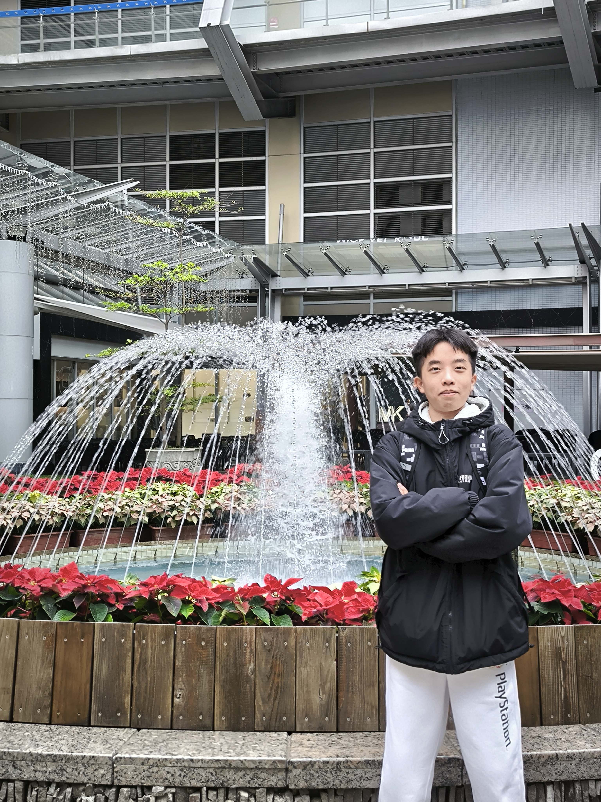
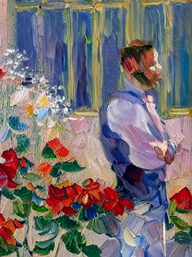
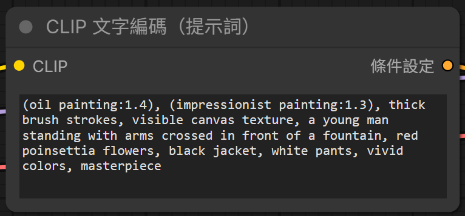
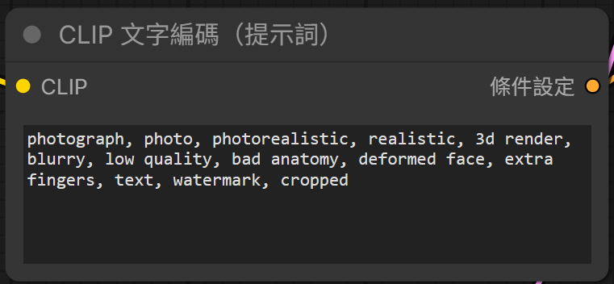
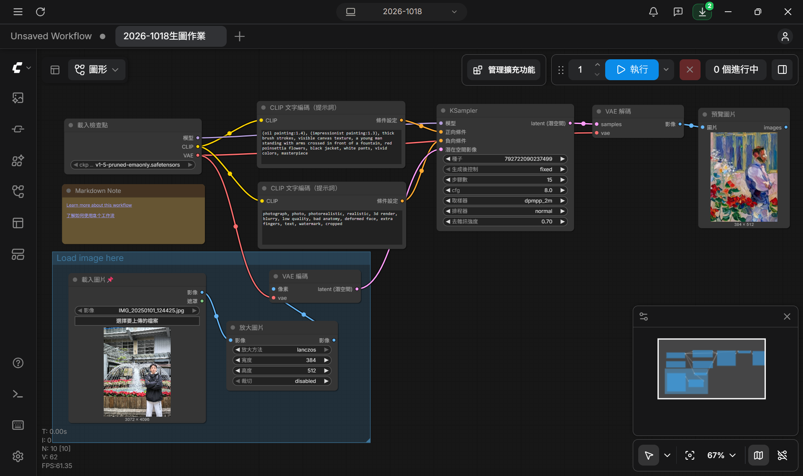

# ComfyUI生成圖片

### 原圖

### 結果圖

# 提示詞

### 正向提示詞

油畫（權重 1.4）、印象派繪畫（權重 1.3）、厚重的筆觸、清晰可見的畫布紋理、一位雙臂交叉站在噴泉前的年輕男子、紅色聖誕紅花朵、黑色外套、白色長褲、鮮豔的色彩、傑作

### 負向提示詞

攝影照片、照片、照片般寫實、寫實風格、3D 渲染、模糊、低品質、錯誤的人體結構、變形的臉、多餘的手指、文字、浮水印、被裁切

# 流程圖

# 個人心得

我的生圖想法是將圖片轉換為油畫風格來呈現。一開始的去雜訊強度只設定5.0，結果出來的圖片慘不忍睹。後來將其提升至7.0，便有了印象派油畫的風格，雖然乍看之下兩張圖差別很大，但仔細一看還是有相似的元素(人物雙手交叉、紅花綠葉)，雖然與我的預期不同，但我覺得很有趣。